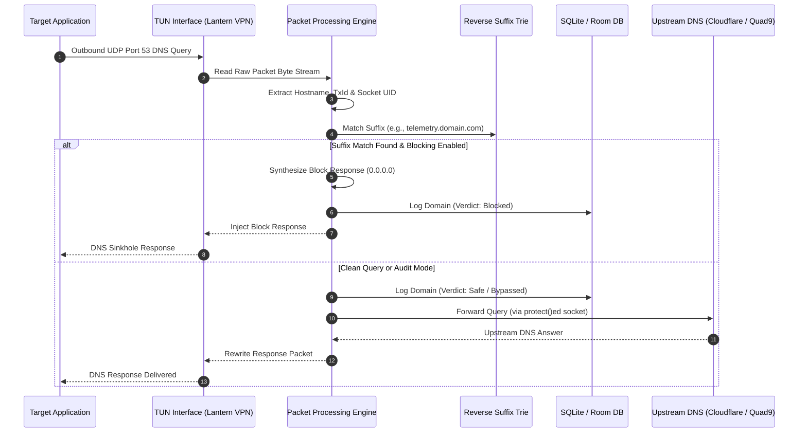

# Lantern

Lantern is a modern, privacy-focused on-device DNS firewall and network telemetry audit tool for Android. Powered by Material 3 Expressive motion and typography, Lantern intercepts, attributes, and classifies outbound DNS queries initiated by installed applications against a database of tracker, ad, and telemetry domains. 

Everything runs 100% locally on-device using Android's VPN subsystem without external cloud proxying or latency penalties.

---

## Key Highlights

- **Active Blocking & Passive Audit Modes**: Switch seamlessly between proactive DNS-sinkholing (`NXDOMAIN` or `0.0.0.0`) to neutralize trackers, or passive audit mode to observe background telemetry without dropping queries.
- **OTA Blocklist Updates**: Built-in background rule updates pulling directly from [StevenBlack/hosts](https://github.com/StevenBlack/hosts) (80,000+ curated hosts) with etag validation and atomic room persistence.
- **Zero-Latency In-Memory Trie**: Suffix matching engine written with an in-memory reverse-label Radix/Suffix Trie yielding $O(k)$ lookup time ($k = \text{domain labels}$).
- **App-Level Socket Attribution**: Tracks socket bindings in real-time to identify exactly which application (app name, icon, and UID) triggered each network request.
- **Material 3 Expressive Design**: Floating capsule dock navigation, Google Sans Flex variable typography, tactile haptic feedback, and a flagship radar hero visualizer.
- **AMOLED Pure Black & Dynamic Color**: Calibrated for true-black OLED displays and system dark/light edge-to-edge system bars.

---

## Technical Architecture

### How Interception Works
1. **Network Interception**: Registers a local-only `VpnService` tunnel routing a sentinel DNS address (`10.0.0.2/32`) to capture outbound port 53 (Do53) traffic.
2. **Packet Parsing**: Reads incoming byte streams directly from the TUN interface descriptor, decoding UDP and DNS wire format headers.
3. **App Attribution**: Maps socket tables and `/proc/net/udp` bindings to process UIDs in real-time, tagging each query with the owning package.
4. **Trie-based Classification**: Evaluates requested hostnames against an 80,000+ domain reverse-label Suffix Trie.
5. **Enforcement & Forwarding**:
   - In **Block Mode**: Returns an immediate synthetic `0.0.0.0` or `NXDOMAIN` response back to the client app.
   - In **Audit Mode** or for **Clean Domains**: Forwards queries to upstream DNS resolvers (Cloudflare, Quad9, Google DNS) using a protected socket context that bypasses the VPN tunnel.



---

## Module Structure

Lantern adheres to clean, modern Android modularization:

```
┌──────────────────────────────────────────────────────────────┐
│                            :app                              │
│  Main application entry point, Dagger Hilt DI bindings,      │
│  LanternNavHost, and edge-to-edge Activity orchestration.   │
└──────────────┬────────────────────────────────┬──────────────┘
               │                                │
               ▼                                ▼
┌──────────────────────────────┐┌──────────────────────────────┐
│           :feature           ││             :vpn             │
│ ViewModels & UI screens:     ││ LanternVpnService lifecycle, │
│ Home, Traffic Stream,        ││ PacketReadLoop, wire parser, │
│ Insights, and Settings.      ││ and socket attributions.     │
└──────────────┬───────────────┘└───────────────┬──────────────┘
               │                                │
               ▼                                ▼
┌──────────────────────────────┐┌──────────────────────────────┐
│            :data             ││        :core:database        │
│ Repository implementations,  ││ Room DB definition, entities │
│ OTA blocklist synchronizers, ││ and query telemetry DAOs.    │
│ and in-memory log buffers.   ││                              │
└──────────────┬───────────────┘└───────────────┬──────────────┘
               │                                │
               └────────────────┬───────────────┘
                                │
                                ▼
┌──────────────────────────────────────────────────────────────┐
│                           :domain                            │
│ Pure Kotlin business domain. Contains models, use cases,     │
│ and repository contracts. Zero Android dependencies.         │
└──────────────────────────────────────────────────────────────┘
```

* **:core:ui**: Material 3 Expressive theme tokens, AMOLED black definitions, custom haptic feedback system, and typography presets.
* **:core:common**: Dispatcher providers, core configurations, and retention constants.

---

## Deep-Dive: Architecture & Engineering Principles

### Why In-Memory Reverse-Label Suffix Trie for 80,000+ Domains?
Evaluating DNS packets in real-time requires sub-millisecond decisions without inducing CPU throttling or network latency:
- **DNS Hierarchy from Right-to-Left**: Domain names resolve hierarchically from the top-level domain backwards (`com` $\to$ `doubleclick` $\to$ `adservice`).
- **The Reverse Suffix Tree**: Domains in Lantern are split by labels and inserted in reverse order into an in-memory `BlocklistTrie`.
- **$O(L)$ Lookup Complexity**: When an app queries `adservice.google.com`, the engine inspects only the label chain (`com` $\to$ `google` $\to$ `adservice`). The search path involves only 2–4 hash pointer jumps, requiring less than **0.05 milliseconds** irrespective of whether the list contains 10,000 or 100,000 rules.
- **Zero Regex Overhead**: Automatic sub-tree inheritance blocks all arbitrary subdomains without wildcards or expensive regular expressions.

### The Role of Upstream Resolvers vs. Android Private DNS
- **Android System Private DNS**: Operates as a black box—encrypts outbound DNS to a remote resolver but offers zero query inspection, no local app attribution, and no on-device tracker neutralizing.
- **Lantern Local Firewall**:
  1. **On-Device Interception**: Terminates tracker queries immediately via local DNS sinkholing before they ever leave the device.
  2. **Upstream Forwarding**: Safe, legitimate traffic is dispatched to user-selected upstream resolvers (Cloudflare, Quad9, Google DNS) over protected sockets that bypass the VPN tunnel, shielding users from ISP DNS hijacking and censorship.

---

## Verification & Compilation

### Requirements
* Android Studio Ladybug / Meerkat (AGP 8.8+)
* Kotlin 2.0+
* Minimum SDK: 29 (Android 10) / Target SDK: 35 (Android 15)
* JDK: Java 17 or 21

### Building the Project
```bash
./gradlew assembleDebug
```

### Running Unit Tests
```bash
./gradlew :vpn:test :data:testDebugUnitTest :domain:test :feature:testDebugUnitTest
```
