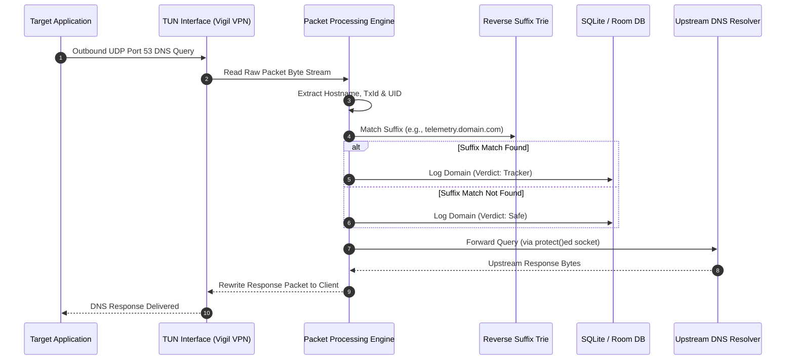

# Vigil

Vigil is a privacy-focused, on-device DNS monitoring tool for Android. It captures and classifies outbound DNS queries initiated by local applications against a bundled database of tracker and telemetry domains. The application processes all network metadata locally on-device without external cloud routing.

---

## Technical Overview

### How it Works
1. **Network Interception**: Registers a local-only VPN tunnel routing a sentinel DNS address (`10.0.0.2/32`) to capture outbound port 53 (Do53) traffic.
2. **Packet Parsing**: Reads incoming byte streams directly from the tunnel file descriptor, decoding UDP headers to extract queried hostnames.
3. **App Attribution**: Maps active socket bindings to process UIDs in real-time, identifying which application initiated the network request.
4. **Trie-based Classification**: Classifies queried domains against an 80,000 hosts database loaded in an in-memory reverse-label Suffix Trie.
5. **Upstream Resolution**: Forwards safe queries to the upstream DNS resolver (e.g., Cloudflare, Google DNS) using a protected socket context that bypasses the VPN tunnel.



---

## Module Architecture

Vigil uses a multi-module architecture structured into seven discrete Gradle modules with strict dependency guidelines:

```
┌──────────────────────────────────────────────────────────────┐
│                            :app                              │
│  Main application entrypoint. Configures Dagger Hilt DI,     │
│  VigilNavHost, and Activity entry points.                   │
└──────────────┬────────────────────────────────┬──────────────┘
               │                                │
               ▼                                ▼
┌──────────────────────────────┐┌──────────────────────────────┐
│           :feature           ││             :vpn             │
│ ViewModels & UI screens.     ││ VigilVpnService lifecycle,   │
│ Controls UI state flows.     ││ PacketReadLoop, packet       │
│                              ││ parser, socket attributions. │
└──────────────┬───────────────┘└───────────────┬──────────────┘
               │                                │
               ▼                                ▼
┌──────────────────────────────┐┌──────────────────────────────┐
│            :data             ││        :core:database        │
│ Repository implementations,  ││ Room DB definition, entities │
│ data mapping, and schedulers ││ and database DAOs.           │
└──────────────┬───────────────┘└───────────────┬──────────────┘
               │                                │
               └────────────────┬───────────────┘
                                │
                                ▼
┌──────────────────────────────────────────────────────────────┐
│                           :domain                            │
│ Pure JVM module. Contains business models, use cases, and    │
│ repository contracts. Depends on zero external components.   │
└──────────────────────────────────────────────────────────────┘
```

* **:core:ui**: Shared UI tokens, themes (System, Catppuccin, Gruvbox, Nord, Dracula, etc.), reusable components, and Geist fonts.
* **:core:common**: Dispatcher providers, core configurations, and retention constants.

---

## Design Choices & Implementation Details

* **In-Memory Trie**: Suffix matching resolved in $O(\text{labels})$ complexity. Matching `example.com` automatically blocks subdomains like `metrics.example.com` without database queries.
* **Batch Log Buffer**: DNS logs are held in a memory buffer and flushed to Room DB (upon reaching 50 items or every 2 seconds) via a Mutex lock to prevent database I/O bottlenecks.
* **Non-Blocking VPN**: Passive audit design. Logs tracker domains but never blocks or alters network traffic, preserving 100% normal connectivity.
* **Private DNS Banner**: Detects active system properties. Surfaces a warning banner if encrypted DNS (DoT/DoH) is active since it bypasses the VPN tunnel.
* **Session Lifecycle cleanup**: Closes active session records (where `endedAt` is null) during repository startup to prevent zombie "Active" states in the history screen.

---

## Screenshots

To display interface snapshots directly in this documentation, add your screenshots to the `/metadata/screenshots/` directory using these file names:

| Screen / Section | Target Filename | Markdown Reference |
|---|---|---|
| **Dashboard** (Monitor status, query counts) | `dashboard.png` | `` |
| **Live Logs** (Real-time captured feeds) | `live_feed.png` | `` |
| **App Statistics** (Per-app tracker metrics) | `app_stats.png` | `` |
| **Settings** (Theme selection, DNS upstream) | `settings.png` | `` |

---

## Verification & Compilation

### Requirements
* Android Studio Hedgehog+ / AGP 9+
* Min SDK: 29 (Android 10) / Target SDK: 34 (Android 14)

### Compilation
```bash
./gradlew assembleDebug --no-configuration-cache
```

### Running Tests
```bash
./gradlew :vpn:test :data:testDebugUnitTest :domain:test :feature:testDebugUnitTest
```
