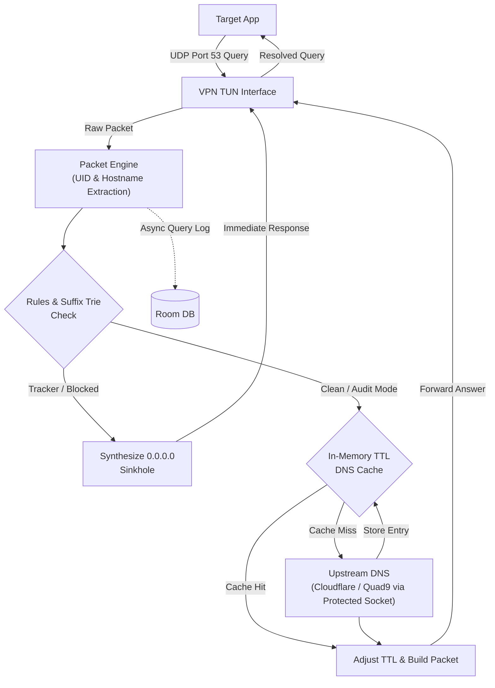

# Lantern (formerly Vigil)

> **Quick heads-up:**  
> This project was originally known as **Vigil** (referenced across my resume and portfolio). After stepping away for a few months, I'm doing a massive overhaul—rewriting core engine parts, redesigning the UI, and adding a bunch of new features.  
> 
> As part of this revamp, I'm renaming the app to **Lantern** and changing the application package name. Because of the package name change, it won't be an in-place upgrade from older Vigil builds; it's practically a fresh, rebuilt app.

Lantern is an on-device DNS firewall and network monitor for Android. It lets you see and block trackers, ads, and background telemetry from apps directly on your phone without sending your traffic through remote servers.

---

## Key Highlights

- **Active Blocking & Passive Audit Modes**: Switch seamlessly between proactive DNS-sinkholing (`NXDOMAIN` or `0.0.0.0`) to neutralize trackers, or passive audit mode to observe background telemetry without dropping queries.
- **Custom Domain Rules & App Whitelisting**: Granular per-domain custom whitelist/blocklist and per-application kernel VPN bypass (`VpnService.Builder.addDisallowedApplication` allowing banking and VoIP apps to communicate directly through the physical network interface).
- **Encrypted DNS Transports (DoH & DoT)**:
  - **DNS-over-HTTPS (DoH - RFC 8484)**: HTTP/2 binary payload framing over TLS port 443 with protected socket pooling.
  - **DNS-over-TLS (DoT - RFC 7858)**: 2-byte length-prefixed raw wire format directly over TLS port 853.
  - Upstream providers supported: Cloudflare, Quad9, Google DNS, with hardcoded bootstrap IPs preventing circular DNS dependency loops.
- **Persistent Live Notification with Remote IPC**: Ongoing silent notification with real-time query counts, threat block percentage, and upstream protocol badges. Features quick notification shade action buttons (`Stop` & `Block/Audit Toggle`) handled by `LanternNotificationReceiver` using `goAsync()` to respect Android 12+ background start limits.
- **Session Forensics & App Drill-Down**: Historical session inspection screen with aggregate query metrics, per-application bandwidth distribution, and interactive modal sheets to filter queries by specific package.
- **Forensic Data Export (RFC 4180 CSV via FileProvider)**: Full forensic CSV export with automated escaping and secure `content://` URI sharing via Android `FileProvider`, requiring zero dangerous storage permissions.
- **High-Performance App Icon Caching**: Thread-safe in-memory drawable caching over Android `PackageManager`, ensuring smooth 120Hz scrolling across traffic feeds and session details.
- **TTL DNS Response Cache & Protected Socket Pool**: 2048-entry in-memory DNS cache honoring TTL to eliminate redundant upstream round-trips with zero latency, backed by thread-safe protected socket pooling.
- **OTA Blocklist Updates**: Built-in background rule updates pulling directly from [StevenBlack/hosts](https://github.com/StevenBlack/hosts) (80,000+ curated hosts) with etag validation and atomic room persistence.
- **Zero-Latency In-Memory Trie**: Suffix matching engine written with an in-memory reverse-label Radix/Suffix Trie yielding $O(k)$ lookup time ($k = \text{domain labels}$).
- **App-Level Socket Attribution**: Tracks socket bindings in real-time to identify exactly which application (app name, icon, and UID) triggered each network request.
- **Material 3 Expressive Design & Predictive Back**: Floating capsule dock navigation, Google Sans Flex variable typography, tactile haptic feedback, fluid 1:1 finger-tracking predictive back navigation gestures with morphing corner radii, and a flagship radar hero visualizer.
- **AMOLED Pure Black & Dynamic Color**: Calibrated for true-black OLED displays and system dark/light edge-to-edge system bars.

---

## Technical Architecture

### How Interception Works
1. **Network Interception**: Registers a local-only `VpnService` tunnel routing a sentinel DNS address (`10.0.0.2/32`) to capture outbound port 53 (Do53) traffic.
2. **Packet Parsing**: Reads incoming byte streams directly from the TUN interface descriptor, decoding UDP and DNS wire format headers.
3. **App Attribution & Bypass**: Maps socket tables and `/proc/net/udp` bindings to process UIDs in real-time, checking if the originating app is whitelisted to bypass the VPN tunnel.
4. **Custom Rules & Trie Classification**: Checks hostname against user custom rules (allow/block) followed by an 80,000+ domain reverse-label Suffix Trie.
5. **Enforcement, In-Memory Caching & Forwarding**:
   - In **Block Mode**: Returns an immediate synthetic `0.0.0.0` or `NXDOMAIN` response back to the client app.
   - For **Allowed Queries**: Inspects the 2048-entry in-memory TTL response cache for instant resolution. On a cache miss, forwards the query to upstream resolvers (Cloudflare, Quad9, Google DNS) either via encrypted **DNS-over-HTTPS (DoH)** or standard UDP using a protected socket pool that bypasses the VPN tunnel.



---

## Module Structure

Lantern adheres to clean, modern Android modularization:

```
┌──────────────────────────────────────────────────────────────┐
│                            :app                              │
│  Main application entry point, Dagger Hilt DI bindings,      │
│  LanternNavHost, and edge-to-edge Activity orchestration.   │
└──────────────┬────────────────────────────────┬──────────────┘
               │                                │
               ▼                                ▼
┌──────────────────────────────┐┌──────────────────────────────┐
│           :feature           ││             :vpn             │
│ ViewModels & UI screens:     ││ LanternVpnService lifecycle, │
│ Home, Traffic Stream,        ││ PacketReadLoop, wire parser, │
│ Insights, Settings, Domain   ││ DnsResponseCache, socket     │
│ Rules, and App Whitelist.    ││ pool, and app attribution.   │
└──────────────┬───────────────┘└───────────────┬──────────────┘
               │                                │
               ▼                                ▼
┌──────────────────────────────┐┌──────────────────────────────┐
│            :data             ││        :core:database        │
│ Repository implementations,  ││ Room DB definition, entities │
│ OTA blocklist synchronizers, ││ and query telemetry DAOs.    │
│ and in-memory log buffers.   ││                              │
└──────────────┬───────────────┘└───────────────┬──────────────┘
               │                                │
               └────────────────┬───────────────┘
                                │
                                ▼
┌──────────────────────────────────────────────────────────────┐
│                           :domain                            │
│ Pure Kotlin business domain. Contains models, use cases,     │
│ and repository contracts. Zero Android dependencies.         │
└──────────────────────────────────────────────────────────────┘
```

* **:core:ui**: Material 3 Expressive theme tokens, AMOLED black definitions, custom haptic feedback system, and typography presets.
* **:core:common**: Dispatcher providers, core configurations, and retention constants.

---

## Deep-Dive: Architecture & Engineering Principles

### Why In-Memory Reverse-Label Suffix Trie for 80,000+ Domains?
Evaluating DNS packets in real-time requires sub-millisecond decisions without inducing CPU throttling or network latency:
- **DNS Hierarchy from Right-to-Left**: Domain names resolve hierarchically from the top-level domain backwards (`com` $\to$ `doubleclick` $\to$ `adservice`).
- **The Reverse Suffix Tree**: Domains in Lantern are split by labels and inserted in reverse order into an in-memory `BlocklistTrie`.
- **$O(L)$ Lookup Complexity**: When an app queries `adservice.google.com`, the engine inspects only the label chain (`com` $\to$ `google` $\to$ `adservice`). The search path involves only 2–4 hash pointer jumps, requiring less than **0.05 milliseconds** irrespective of whether the list contains 10,000 or 100,000 rules.
- **Zero Regex Overhead**: Automatic sub-tree inheritance blocks all arbitrary subdomains without wildcards or expensive regular expressions.

### The Role of Upstream Resolvers vs. Android Private DNS
- **Android System Private DNS**: Operates as a black box—encrypts outbound DNS to a remote resolver but offers zero query inspection, no local app attribution, and no on-device tracker neutralizing.
- **Lantern Local Firewall**:
  1. **On-Device Interception**: Terminates tracker queries immediately via local DNS sinkholing before they ever leave the device.
  2. **Upstream Forwarding**: Safe, legitimate traffic is dispatched to user-selected upstream resolvers (Cloudflare, Quad9, Google DNS) over protected sockets that bypass the VPN tunnel, shielding users from ISP DNS hijacking and censorship.

---

## Verification & Compilation

### Requirements
* JDK 17 or 21
* Minimum SDK: 29 (Android 10)
* Target SDK: 36 (Android 16) / Compile SDK: 37

### Building the Project
```bash
./gradlew assembleDebug
```

### Running the Complete Test Suite
```bash
./gradlew testDebugUnitTest test
```

### Building On-Device Instrumentation Tests
```bash
./gradlew assembleDebugAndroidTest
```

---

## License & Privacy

- **License**: Lantern is free and open-source software licensed under the [GNU General Public License v3.0 (GPLv3)](LICENSE).
- **Privacy Policy**: 100% on-device processing with zero data collection, zero tracking SDKs, and zero telemetry. Read the full [Privacy Policy](PRIVACY.md).

```text
Lantern - On-device DNS firewall and network monitor for Android
Copyright (C) 2026 Masum

This program is free software: you can redistribute it and/or modify
it under the terms of the GNU General Public License as published by
the Free Software Foundation, either version 3 of the License, or
(at your option) any later version.
```
